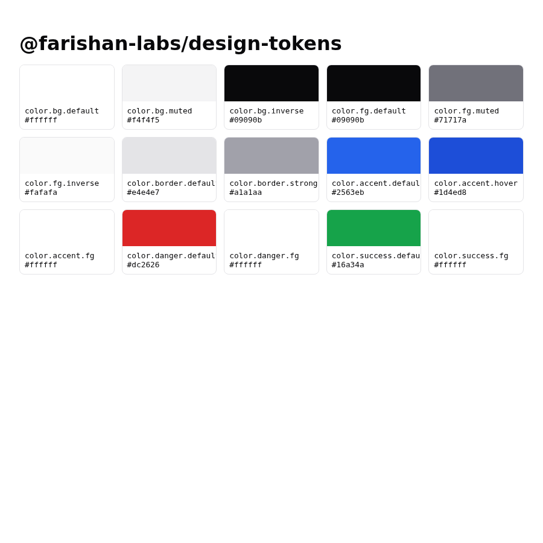

# @farishan-labs/design-tokens

W3C DTCG design tokens for Faris Han Labs. Cross-platform: web (CSS vars),
TypeScript constants, and (later) TUI/native mappings. Apache-2.0.



## Install

```bash
bun add @farishan-labs/design-tokens
```

## Usage

```ts
import { tokens } from "@farishan-labs/design-tokens";
```

```html
<link rel="stylesheet" href="node_modules/@farishan-labs/design-tokens/src/tokens/tokens.css" />
```

## Preview

Render a local, offline swatch preview of any DTCG tokens file:

```bash
bun run preview                      # uses src/tokens/tokens.json
bun run preview -- path/to/tokens.json
```

Writes `dist/preview.html` and opens it in the default browser. View-only
(no editing). Reuse Engramma if an embedded editor is needed.

## Development

```bash
bun install
bun run check
bun test
bun run gen:tokens
```

## Research basis

`research/topics/farishan-labs-ui/` (P4 tokens as SSOT).
